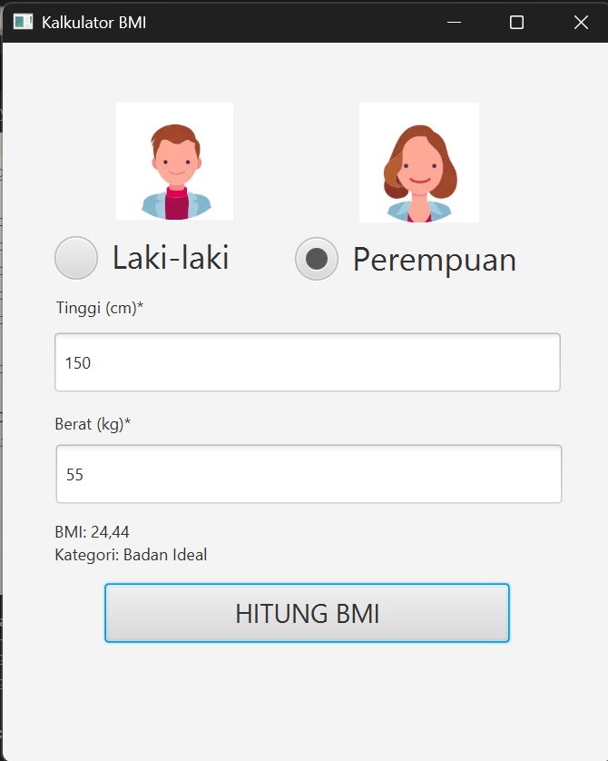

# Kalkulator BMI

Aplikasi Kalkulator BMI merupakan aplikasi desktop berbasis Java yang dikembangkan menggunakan JavaFX untuk membangun Graphical User Interface (GUI). Aplikasi ini dibuat untuk menghitung Body Mass Index (BMI) berdasarkan data tinggi badan, berat badan, dan pilihan jenis kelamin yang dimasukkan oleh pengguna. Hasil perhitungan akan ditampilkan melalui antarmuka aplikasi beserta kategori BMI.

## Fitur

- Input tinggi badan dalam satuan sentimeter (cm).
- Input berat badan dalam satuan kilogram (kg).
- Pilihan jenis kelamin.
- Perhitungan Body Mass Index (BMI).
- Menampilkan hasil perhitungan BMI.
- Menampilkan kategori berdasarkan hasil BMI.
- Validasi input untuk memastikan data yang dimasukkan sesuai.

## Tampilan Aplikasi



## Rumus Perhitungan

BMI dihitung menggunakan rumus berikut:

BMI = Berat Badan (kg) / Tinggi Badan (m)²

## Struktur Project

```text
KalkulatorBMI/
├── src/
│   └── main/
│       ├── java/
│       │   ├── main/
│       │   │   └── Main.java
│       │   ├── controller/
│       │   │   └── KalkuBmiController.java
│       │   └── model/
│       │       └── Bmi.java
│       └── resources/
│           └── fxml/
│               └── KalkuBmi.fxml
├── screenshots/
│   └── kalkulatorBMI.png
├── pom.xml
└── README.md
```

## Cara Menjalankan

1. Clone atau download repository ini.
2. Buka project menggunakan Apache NetBeans atau IDE Java yang mendukung Maven.
3. Pastikan JDK dan konfigurasi JavaFX sudah sesuai.
4. Tunggu hingga Maven selesai mengunduh dependensi yang dibutuhkan.
5. Jalankan aplikasi melalui terminal dengan perintah:

   ```bash
   mvn clean javafx:run
   ```

   Atau jalankan menggunakan konfigurasi Maven `javafx:run` yang tersedia di IDE.

## Cara Menggunakan Aplikasi

1. Jalankan aplikasi Kalkulator BMI.
2. Pilih jenis kelamin.
3. Masukkan tinggi badan pada kolom yang tersedia.
4. Masukkan berat badan pada kolom yang tersedia.
5. Klik tombol **Hitung BMI**.
6. Hasil perhitungan dan kategori BMI akan ditampilkan pada aplikasi.

